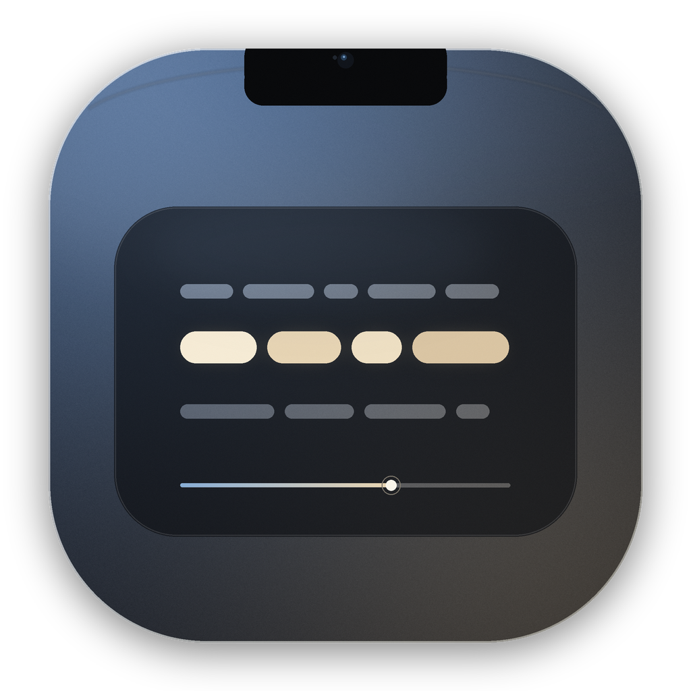

# Nook

  

  <strong>把视线留在镜头里。</strong> 
  悬浮在 Mac 刘海下方的英文提词器，带 AI 断句、Linear 工作区和官方 Liquid Glass。

Nook 是一个为英文自我介绍、面试和短演讲准备的小型 macOS 提词器。它把讲稿拆成适合换气的短句，以逐词填光的方式提示节奏；提词窗固定在刘海正下方，读稿时视线自然落在摄像头附近。

## 1.1 新特性

- **严格不改写原文的 AI 断句**：本地 tokenizer 先给每个词编号，云端 OpenAI-compatible 模型只返回行边界、行尾停顿和强调索引；显示文本始终来自本地 token，模型无法改写、翻译或增删讲稿。
- **只在 Start 时联网**：输入、拖动滑杆和编辑讲稿都不会触发网络请求。配置不完整、请求失败或取消时，编辑器会明确显示状态，不会悄悄使用降级结果。
- **Linear 风格编辑器**：近黑画布、1 px 分隔线、克制的 periwinkle 强调色、296 pt 检查器、文档优先的排版。
- **官方 Liquid Glass 提词面板**：macOS 26+ 使用系统 glassEffect；旧系统使用 NSVisualEffectView fallback。
- **Apple Music 式歌词动效**：三行歌词栈、逐词填光、行切换弹簧、上一行 / 下一行淡出与模糊，以及极细进度轨。
- **本地回退**：没有 API key 或 AI 失败时，可以用本地断句立即开始；面板来源显示 LOCAL 或 AI。
- **Keychain 保存密钥**：API key 只进 macOS Keychain，不写入 UserDefaults、日志、缓存、错误信息或仓库。

## 快速开始

环境要求：macOS 14 或更新版本，已安装 Xcode Command Line Tools。

~~~bash
cd "/Users/yukisala/subject/提词器"
./scripts/build.sh
open dist/Nook.app
~~~

或者一步构建并启动：

~~~bash
./scripts/run.sh
~~~

Nook 是菜单栏应用，不显示 Dock 图标。首次启动会打开编辑器。

## AI 设置

1. 点击右上角 **AI settings**，或右侧 **Configure AI**。
2. 选择 provider preset，或填入自己的 **Base URL** 和 **model**。
3. 填入 API key；保存后 key 只存在于 Keychain，输入框会被清空。
4. **Test connection** 只做一次很短的连通性测试，不会开始提词。
5. **Save** 保存 endpoint/model；**Clear key** 只删除密钥，保留 endpoint 和 model。

Base URL 必须是 HTTPS；http 仅允许 localhost / 127.0.0.1 / ::1。带 userinfo 或 query parameter 的 URL 会被拒绝，避免把凭据写进 UserDefaults。

Start 时的流程：

- 没有配置或没有 key：直接使用本地断句，面板显示 LOCAL。
- 配置完整：先进入 AI planning；成功后显示 AI plan，失败时编辑器保留并显示错误横幅。
- **Retry AI** 重新请求；**Start locally** 立即用本地断句开始；**Settings** 回到设置。
- 请求成功后按 script hash + model + prompt version + tokenizer version + budget 缓存；再次 Start 会优先命中缓存。

## 使用

1. 粘贴或输入英文讲稿。空行会产生更长的段落停顿。
2. 选择语速预设（Measured / Natural / Interview），或拖动 WPM 滑杆；默认 **138 WPM**。
3. 按 **⌘↩** 或点击 **Start**。配置了 AI 时会先规划；否则直接用 LOCAL 开始。
4. 提词窗出现在刘海正下方，2 秒 READY 后进入朗读。窗口鼠标穿透，不抢焦点。
5. 需要调整时用全局快捷键，或点菜单栏的 Nook 图标。

### 全局快捷键

| 快捷键 | 动作 |
| --- | --- |
| **⌃⌥Space** | 播放 / 暂停 |
| **⌃⌥← / →** | 上一句 / 下一句 |
| **⌃⌥↑ / ↓** | 加快 / 放慢语速（每次 5 WPM） |
| **⌃⌥R** | 从头开始 |
| **⌃⌥H** | 显示 / 隐藏提词窗 |
| **⌃⌥E** | 打开编辑器 |

## 隐私与数据

- 讲稿和偏好保存在本机 UserDefaults；API key 只在 Keychain。
- 请求只发送到用户配置的 endpoint，请求体只包含 token、行预算、WPM 和输出 schema；不包含其他本机内容。
- 屏幕共享隐藏默认开启，使用 NSWindow.sharingType = .none。硬件采集卡或对着屏幕拍摄无法被它阻止。
- 预览截图使用隔离的 UserDefaults suite 和合成背景，不读取用户真实讲稿或真实桌面。

## 断句与节奏

Nook 不会改写文字，只决定怎么分组和停留多久：

1. 本地 tokenizer 分句、处理缩写和句首 initials、保留 em dash。
2. AI 只返回 token 索引、行尾停顿和强调索引；validator 修复跨句、gap、越界、重复和预算问题。
3. 没有可用 AI plan 时，HeuristicPhrasePlanner 使用本地测量宽度产生呼吸组。
4. 根据音节数计算词时长，按 WPM 校准；行内逐词推进。
5. 遇到标点时延长停留，句末和段落末再增加呼吸。每一行只属于一个句子。
6. 渲染前会按真实字体宽度再次测量和切分，避免歌词被裁切。

## 项目结构

~~~text
Sources/NookKit/SpeechScript.swift       # tokenizer / SpeechScript
Sources/NookKit/PhrasePlan.swift         # PhrasePlan / validator / budget
Sources/NookKit/PhraseLayout.swift       # 真实字体宽度测量与语义切分
Sources/NookKit/HeuristicPhrasePlanner.swift
Sources/NookKit/PromptComposer.swift     # plan → PromptDocument
Sources/NookKit/LLMConfiguration.swift   # endpoint / provider / UserDefaults
Sources/NookKit/KeychainStore.swift      # Keychain SecretStore
Sources/NookKit/PhrasePlanningPrompt.swift
Sources/NookKit/HTTPTransport.swift
Sources/NookKit/OpenAICompatibleClient.swift
Sources/NookKit/PhrasePlanCache.swift
Sources/NookKit/AIPlanningCoordinator.swift
Sources/Nook/AppModel.swift              # 讲稿、AI 状态、Start 流程
Sources/Nook/LinearDesign.swift          # Linear tokens 与 controls
Sources/Nook/EditorChrome.swift          # top bar / status / error banner
Sources/Nook/ScriptPane.swift
Sources/Nook/InspectorPane.swift
Sources/Nook/AISettingsOverlay.swift
Sources/Nook/OfficialGlassSurface.swift
Sources/Nook/KaraokeLyricsView.swift
Sources/Nook/LyricProgressRail.swift
Sources/Nook/TeleprompterView.swift      # 官方玻璃歌词舞台
Sources/Nook/TeleprompterController.swift # 刘海定位、NSPanel、窗口动画
Sources/Nook/PlaybackEngine.swift        # 播放时钟与进度
Sources/Nook/AppDelegate.swift           # 菜单栏、全局快捷键、预览
Tests/NookKitTests/                      # 无第三方依赖的检查程序
Tools/GlassSpike/GlassSpike.swift        # 官方玻璃可行性 spike
scripts/build.sh                         # 使用 swiftc 构建 .app
scripts/test.sh                          # 编译并运行检查
~~~

## 验证

~~~bash
./scripts/test.sh
./scripts/build.sh
~~~

当前自动化检查覆盖 tokenizer、PhrasePlan 修复与预算、真实宽度切分、composer 时间轴、配置与 Keychain、prompt、HTTP client、缓存、coordinator 状态机和示例讲稿输出。共 **511 项检查**通过。

已验证：

- 提词窗 736 × 261 pt（含透明阴影边距），可见玻璃卡片 680 × 205 pt；
- 卡片顶部距刘海安全区底部约 7 pt，水平居中于摄像头；
- 官方 glassEffect 在 macOS 27 上渲染为真实半透明玻璃；
- 开启隐藏后提词窗从 screencapture 中消失，同时窗口仍在屏幕上；
- 编辑器在 960 × 680 和 1040 × 720 下可用；
- 屏幕共享隐藏、鼠标穿透、快捷键保持不变。

未做真实云端调用验收：仓库不包含 API key，真实 provider 的连通性需要用户在自己的机器上配置 key 后测试。

## 构建说明

项目没有使用 SwiftPM/Xcode 工程，因为当前机器只安装了 Command Line Tools，且该环境下的 SwiftUI 宏插件不完整。构建脚本直接调用 swiftc，部署目标为 macOS 14。界面状态全部由 AppKit/SwiftUI ObservableObject 驱动，避免 @State 等宏。

生成图标（可选）：

~~~bash
python3 scripts/make-icon.py
~~~

## 安装

~~~bash
./scripts/build.sh
ditto dist/Nook.app /Applications/Nook.app
~~~

bundle id 保持 app.nook.teleprompter；覆盖安装不会清空 UserDefaults 或 Keychain。

## 已知边界

- 目前以英文为第一优先级；中文不会被按字切开。
- 固定显示在带刘海的屏幕；无刘海屏时回退到主屏幕菜单栏下方居中。
- 官方 Liquid Glass 需要 macOS 26+；旧系统使用 NSVisualEffectView fallback。
- 没有麦克风语音跟随；节奏由 WPM、音节、标点和 AI plan 决定。
- ad-hoc 签名适合本机使用；分发到其他机器需要重新签名。
