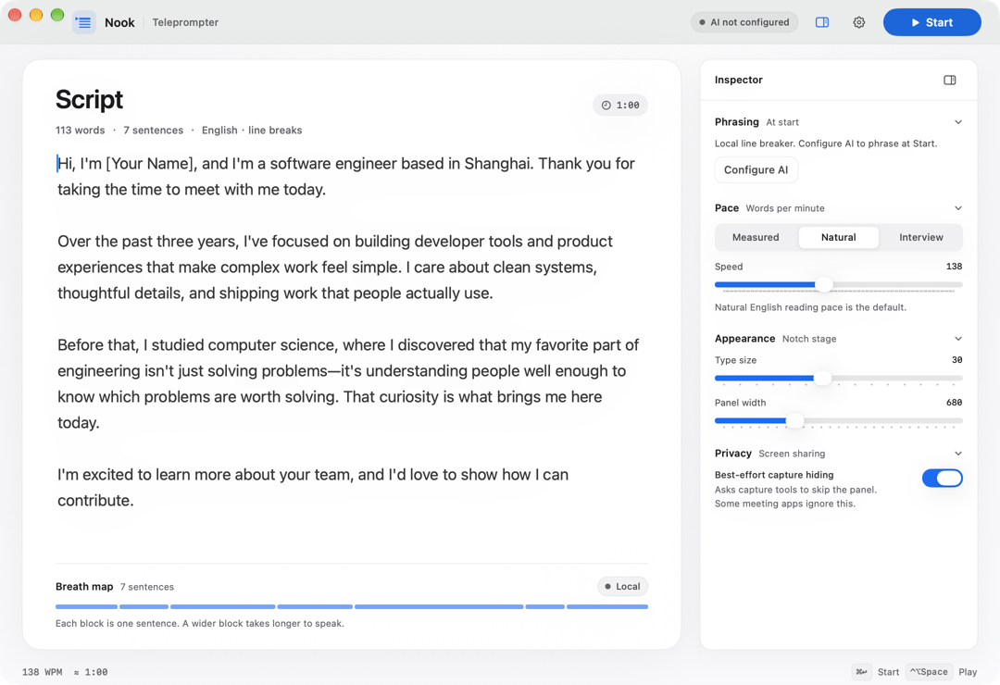
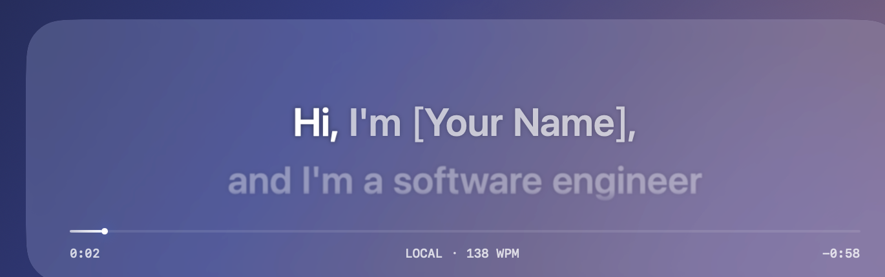

# 01 产品说明

## 读完能做什么

你能用三句话说清 Nook 的产品目标、目标用户和两个界面。

## Nook 是什么

Nook 是一个 macOS 提词器。

它把英文讲稿拆成短句。这些短句适合换气。

开始提词后，提词面板停在 Mac 刘海下方。你的眼睛靠近摄像头。

## 用户是谁

目标用户只有一个人。

这个人要准备英文自我介绍。场景是面试、短演讲或视频录制。

用户需要三件事：

1. 把讲稿排成自然的呼吸节奏。
2. 看着镜头附近读稿。
3. 不让他人看到提词面板。

## 两个界面

### 编辑窗口

编辑窗口负责准备。

- 左侧是白色稿纸。
- 右侧是检查器。
- 顶栏有 AI 状态和 Start 按钮。
- 底部的呼吸图显示每句的时长。

窗口最小 960 × 680。推荐 1080 × 740。

### 提词面板

演示背景是合成图。
截图不包含真实桌面和真实讲稿。

提词面板负责朗读。

- 面板浮在刘海下方。
- 面板不抢焦点。
- 鼠标可以穿透。
- 当前行逐词变亮。
- 底部有进度条和时间。

## 一次完整使用

1. 打开 Nook。
2. 粘贴英文讲稿。
3. 选择语速。
4. 按 ⌘↩。
5. Nook 请求 AI 断句，或使用本地断句。
6. 编辑窗口隐藏，提词面板出现。
7. 按 ⌃⌥Space 暂停或继续。
8. 读完后按 ⌃⌥E 回到编辑窗口。

## Nook 不做什么

- 不改写讲稿。
- 不监听麦克风。
- 不做语音识别。
- 不保存到云端。
- 不做多讲稿管理。

## 下一步

读 [02 快速开始](02-quick-start.md)，在本机运行 Nook。
