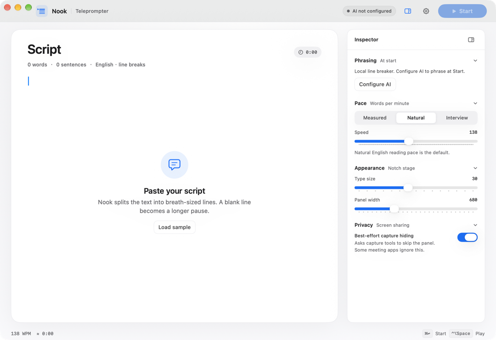
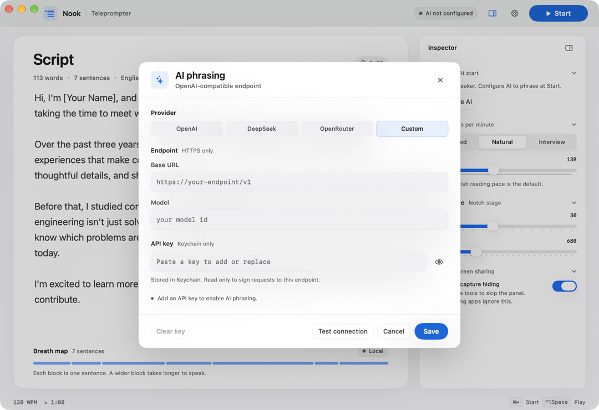

# 02 快速开始

## 读完能做什么

你能在本机构建 Nook，完成第一次提词，并确认每个环节正常。

## 环境要求

- macOS 14 或更新版本。
- 已安装 Xcode Command Line Tools。
- 磁盘有约 100 MB 空闲空间。

检查工具：

~~~bash
xcode-select -p
swiftc --version
~~~

两条命令都应成功。

## 构建

进入项目目录：

~~~bash
cd "/Users/yukisala/subject/提词器"
~~~

运行构建脚本：

~~~bash
./scripts/build.sh
~~~

脚本做四件事：

1. 收集全部 Swift 源文件。
2. 调用 swiftc 编译。
3. 组装 dist/Nook.app。
4. 做 ad-hoc 签名。

看到 `Built .../dist/Nook.app` 表示成功。

## 启动

~~~bash
open dist/Nook.app
~~~

Nook 是菜单栏应用。它不显示 Dock 图标。

首次启动会打开编辑窗口。

## 第一次提词

第一次启动时，稿纸是空的。

1. 在稿纸中输入或粘贴英文讲稿。
2. 在检查器中选择 Natural。
3. 按 ⌘↩。
4. 等待面板出现。
5. 读完后按 ⌃⌥E。

如果还没有 API key，Nook 会使用本地断句。面板来源显示 LOCAL。

## 配置 AI（可选）

1. 点击顶栏齿轮，或按 ⌘,。
2. 选择 provider。
3. 填写 Base URL 和 model。
4. 粘贴 API key。
5. 点击 Test connection。
6. 点击 Save。

密钥只写入 macOS Keychain。保存后输入框会清空。

## 确认成功

依次检查：

- 编辑窗口显示讲稿字数。
- 呼吸图显示每句的块。
- 按 ⌘↩ 后出现玻璃面板。
- 面板显示 READY，然后开始播放。
- ⌃⌥Space 能暂停。

全部通过，说明安装正常。

## 失败怎么办

### 构建失败

运行 `xcode-select -p`。它应指向 Command Line Tools 或 Xcode。

### 打开被阻止

系统设置 → 隐私与安全性 → 仍要打开。

### 面板不出现

确认屏幕有刘海。无刘海屏会回退到主屏幕。

更多问题见 [08 故障排查](08-troubleshooting.md)。

## 下一步

读 [03 概念与术语](03-concepts.md)，建立数据流的心智模型。
