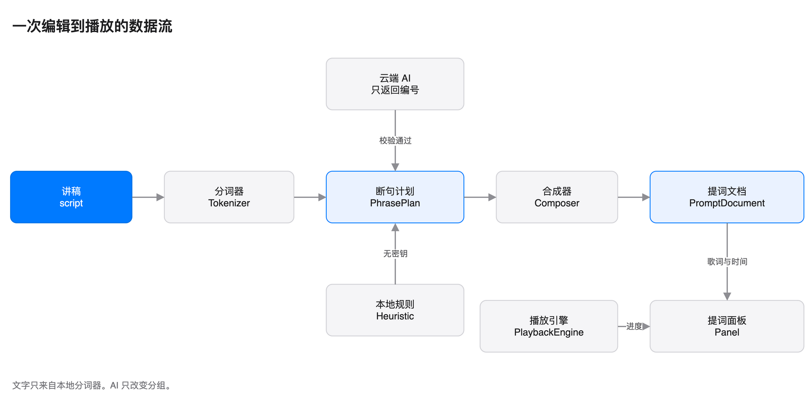

# 03 概念与术语

## 读完能做什么

你能用 12 个术语描述数据流。你也能解释 AI 为什么不能改写讲稿。

## 术语表

| 术语 | 英文 | 含义 |
| --- | --- | --- |
| 讲稿 | script | 用户输入的英文文本 |
| 词元 | token | 分词后的一个词或标点 |
| 句子 | sentence | 以句末标点结束的单位 |
| 段落 | paragraph | 用空行分隔的单位 |
| 断句计划 | phrase plan | 一组行边界和停顿 |
| 呼吸行 | breath line | 提词时显示的一行 |
| 提词文档 | prompt document | 带时间的完整播放数据 |
| 语速 | WPM | 每分钟朗读的单词数 |
| 计划来源 | plan source | AI 或本地 |
| 提词面板 | panel | 刘海下方的提词窗口 |
| 编辑窗口 | editor | 准备讲稿的窗口 |
| 缓存 | cache | 按讲稿哈希保存的断句计划 |

## 心智模型

数据只向一个方向流动。

1. 讲稿进入分词器。
2. 分词器产生词元。
3. 断句计划决定换行和停顿。
4. 合成器产生提词文档。
5. 提词面板读取文档并播放。

## 词元是什么

词元是显示的最小单位。

例如：

~~~text
Hi, I'm [Your Name], and I'm a software engineer.
~~~

分词后得到：

~~~text
Hi, | I'm | [Your | Name], | and | I'm | a | software | engineer.
~~~

标点跟着前一个词。这样换行时不会拆开标点。

## 断句计划是什么

断句计划只描述三件事：

1. 每一行结束在哪个词。
2. 行尾停多久。
3. 哪些词需要强调。

计划不包含文字。计划只包含词元的编号。

## 提词文档是什么

提词文档是播放数据。

每个词有六个字段：

- 编号
- 文本
- 开始时间
- 结束时间
- 所属行
- 所属句子

时长由开始时间和结束时间算出。

面板只读取提词文档。面板不读讲稿。

## 为什么 AI 不改写

AI 收到词元编号和文本。

AI 只能返回编号。

校验器检查三件事：

1. 编号不越界。
2. 行不跨句。
3. 停顿不为负。

校验器还会补齐编号缺口。

显示文字始终来自本地词元。模型无法改字、翻译或增删。

## 计划来源

来源只有两个值。

- **AI**：云端模型返回计划，并通过校验。
- **本地**：启发式规划器返回计划。

界面用 Local 或 AI plan 标记来源。

## 自测

1. 讲稿和提词文档有什么区别？
2. 断句计划包含文字吗？
3. 词元编号越界时会发生什么？
4. 没有 API key 时面板显示什么来源？
5. 面板读取讲稿还是文档？

答案在本页和前两篇文档中。

## 下一步

读 [04 架构](04-architecture.md)，看这些概念落在哪些文件。
