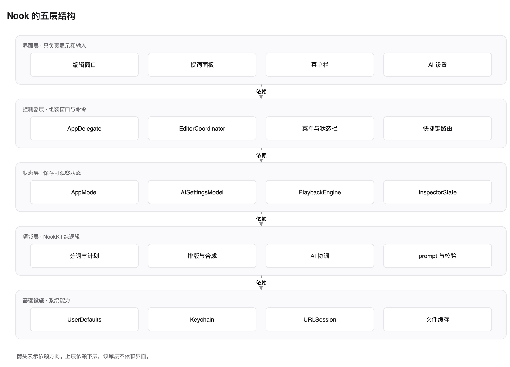
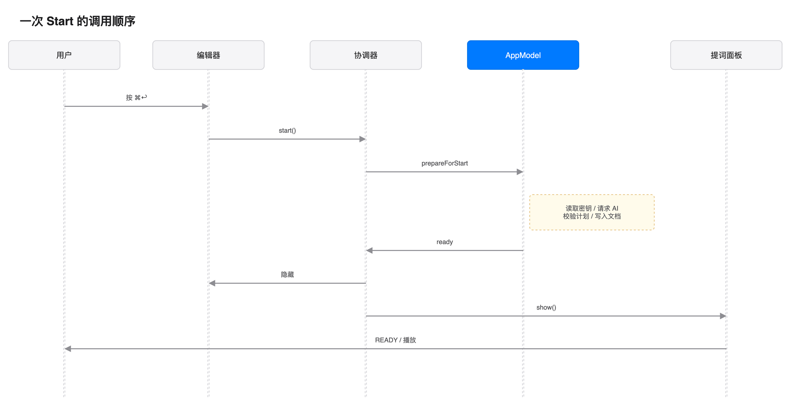
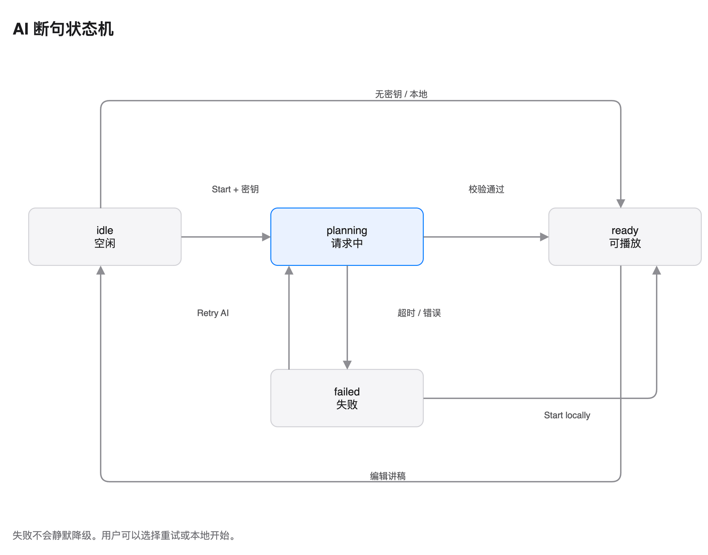
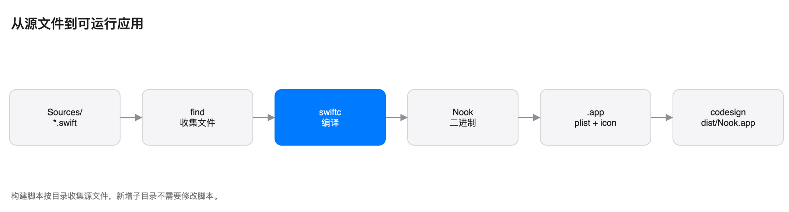

# 04 架构

## 读完能做什么

你能画出五层结构。你也能说出一次 Start 的顺序。

## 五个层

| 层 | 负责 | 例子 |
| --- | --- | --- |
| 界面 | 画界面、接收输入 | EditorView、ScriptPaper、TeleprompterView |
| 控制器 | 组装窗口、菜单、快捷键 | AppDelegate、EditorCoordinator、MenuBarController |
| 状态 | 保存界面状态 | AppModel、AISettingsModel、PlaybackEngine |
| 领域 | 分词、断句、排版、请求 | NookKit |
| 基础设施 | 文件、网络、密钥 | UserDefaults、URLSession、Keychain |

依赖只向下。

- 界面依赖状态。
- 状态依赖领域。
- 领域依赖系统框架。
- 领域不依赖界面。

NookKit 同时存放领域代码和基础设施代码。
分层看类型，不只看目录。

## 目录

~~~text
Sources/NookKit/
  Core/        SpeechScript、PhrasePlan、PhraseLayout、PromptScript
  Planning/    HeuristicPhrasePlanner、PromptComposer、AIPlanningCoordinator
  Providers/   LLMConfiguration、HTTPTransport、OpenAICompatibleClient
  Storage/     KeychainStore、PhrasePlanCache、PreferencesStore、ScriptDocumentBuilder

Sources/Nook/
  App/         NookMain、AppDelegate、EditorCoordinator、MenuBarController、
               ApplicationMenuController、HotKeyRouter、PreviewHarness、
               EditorWindowController、GlobalHotKeys
  Model/       AppModel、AISettingsModel、NookTime
  Editor/      EditorView、EditorToolbar、ScriptPaper、ScriptTextView、
               BreathRibbon、InspectorPane、AISettingsOverlay、EditorStatusBar
  DesignSystem/ NookTokens、NookMotion、NookComponents、NookCanvas
  Teleprompter/ TeleprompterController、TeleprompterView、KaraokeLyricsView、
               LyricProgressRail、OfficialGlassSurface、PlaybackEngine
~~~

## 谁创建谁

AppDelegate 是主要组装点。

它按顺序创建：

1. AppModel。
2. PlaybackEngine。
3. TeleprompterController。
4. EditorCoordinator。
5. ApplicationMenuController。
6. MenuBarController 与 HotKeyRouter。

EditorCoordinator 会按需创建 EditorWindowController。

除此之外，其他对象不创建窗口和控制器。

## 数据流

编辑时：

1. 文本进入 AppModel。
2. AppModel 写入 PreferencesStore。
3. 160 毫秒后开始重建。
4. AppModel 调用分词器。
5. ScriptDocumentBuilder 选择计划并生成文档。
6. 结果写入 PromptDocument。
7. 界面读取 PromptDocument。

提词时：

1. PlaybackEngine 按时间推进。
2. 面板读取 PromptDocument 和播放进度。
3. 歌词视图把词染成白色。

## 一次 Start 的顺序

1. 用户按 ⌘↩。
2. EditorToolbar 调用 EditorActions.start。
3. EditorCoordinator 请求 AppModel.prepareForStart。
4. AppModel 读取 Keychain 中的密钥。
5. 有密钥时进入 AIPlanningCoordinator。
6. 没有密钥时使用本地规划器。
7. 成功后写入断句计划。
8. 编辑窗口淡出。
9. 提词面板弹入。
10. 播放引擎开始计时。

失败时保留编辑窗口，并显示错误横幅。

## AI 状态机

界面状态有四个：

- idle：空闲。
- planning：请求中。
- failed：失败，等待重试。
- ready：有可用计划。

代码中 AppModel 只存前三个。
ready 表示有可用计划，并且没有错误。

失败不会自动降级。用户可以选择重试或本地开始。

## 构建管线

1. build.sh 用 find 收集源文件。
2. swiftc 一次编译全部文件。
3. 生成可执行文件 Nook。
4. 复制 Info.plist 和图标。
5. 做 ad-hoc 签名。
6. 输出 dist/Nook.app。

## 面板位置

面板位置由 `TeleprompterController.targetWindowFrame()` 计算。

步骤：

1. 找有刘海的屏幕。
2. 读取安全区高度和菜单栏高度。
3. 取两者较大值作为顶部内缩。
4. 卡片顶部 = 屏幕顶部 − 内缩 − 7。
5. 窗口宽度 = 卡片宽度 + 两侧边距。
6. 窗口水平居中。
7. 窗口底部 = 卡片顶部 − 卡片高度 − 边距。

无刘海屏时回退到主屏幕。

调试命令见 [06 开发指南](06-development.md)。

## 为什么没有 SwiftPM

本机只安装了 Command Line Tools。

SwiftPM 和 SwiftUI 宏插件不完整。

因此项目直接调用 swiftc。

代价有三点：

- 没有标准测试报告。
- 没有 asset catalog。
- 无法 notarize。

这些代价写在 [06 开发指南](06-development.md)。

## 并发模型

- 所有界面和控制器都在主线程。
- AppModel、AISettingsModel 和控制器标注 @MainActor。
- NookKit 的纯逻辑不标注。
- AppKit 回调回到主线程时使用 MainActor.assumeIsolated。

## 状态边界

- AppModel 管讲稿、语速、字号和计划。
- AISettingsModel 管密钥草稿和连接测试。
- PlaybackEngine 管时间和进度。
- 三者互不写入对方的字段。

这样设置面板输入不会让编辑区重绘。

## 行为不变的保证

- 558 项检查覆盖分词、计划、排版、缓存、配置和网络。
- 每次重构只改结构，不改输出。
- 关键行为用截图对比。

## 下一步

读 [05 设计系统](05-design-system.md)，看界面如何落实这些结构。
