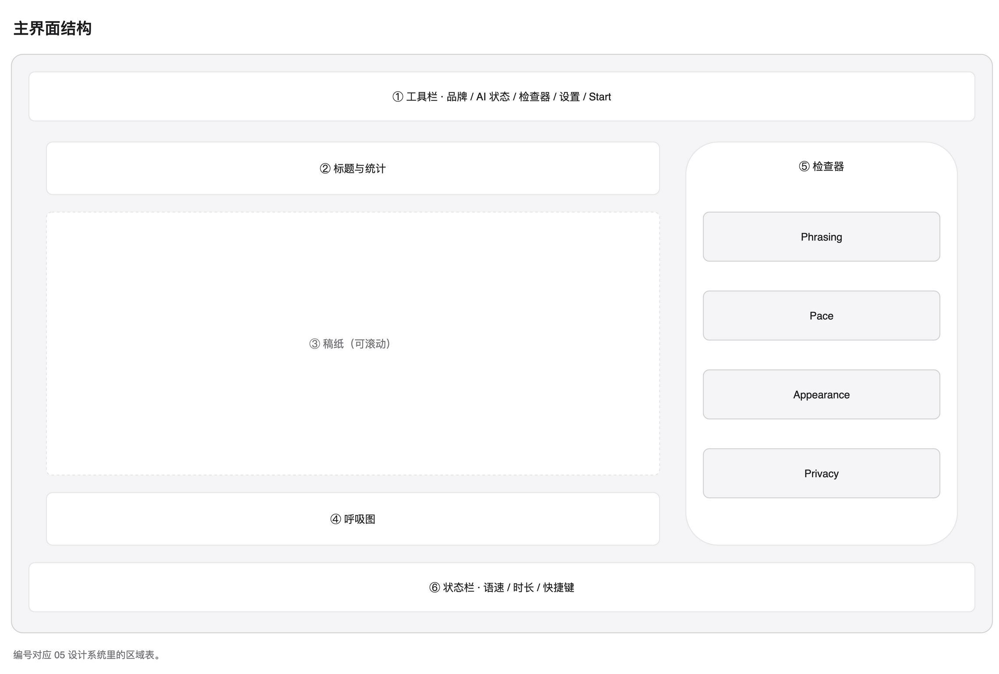

# 05 设计系统

## 读完能做什么

你能找到颜色、字号和动效的来源。你也能安全地修改样式。

## 设计目标

主界面叫 Quiet Studio。

它像一张放在浅色桌面上的纸。

- 画布是浅灰。
- 纸张是纯白。
- 文字是石墨色。
- 只有一个强调色：系统蓝。
- 动效只解释状态变化。

## 主界面结构

| 区域 | 高度或宽度 | 代码 |
| --- | --- | --- |
| 工具栏 | 48 | EditorToolbar |
| 纸张 | 最大 720 | ScriptPaper |
| 检查器 | 300 | InspectorPane |
| 状态栏 | 28 | EditorStatusBar |
| 窗口 | 最小 960 × 680 | EditorWindowController |

工具栏每一项都有菜单命令。

## 颜色

颜色定义在 `Sources/Nook/DesignSystem/NookTokens.swift`。

| Token | 值 | 用途 |
| --- | --- | --- |
| canvasTop | #F5F5F7 | 画布顶部 |
| canvasBottom | #FAFAFC | 画布底部 |
| paper | #FFFFFF | 纸张 |
| surfaceMuted | #F2F2F4 | 控件槽、标签底 |
| border | #E5E5EA | 0.5 pt 分隔线 |
| borderStrong | #D1D1D6 | 强调边线 |
| textPrimary | #1D1D1F | 正文与标题 |
| textSecondary | #515154 | 次要说明 |
| textTertiary | #6E6E73 | 辅助信息 |
| accent | #007AFF | 唯一强调色 |
| accentPressed | #0063D1 | 按下状态 |
| success | #1F7A34 | AI ready |
| warning | #B25000 | 请求中 |
| danger | #D70015 | 错误 |

对比度要求：

- 正文不低于 4.5:1。
- 大字不低于 3:1。

## 字体

字体定义在 NookTokens.swift 的 `NookType`。

| Token | 字号 | 用途 |
| --- | --- | --- |
| display | 28 semibold | 纸张标题 |
| title | 17 semibold | 区块标题 |
| body | 17 regular | 正文 |
| callout | 13 regular | 说明 |
| caption | 11 medium | 标签 |
| micro | 10 regular | 辅助文字 |
| mono | 10.5 medium | 数字与快捷键 |

正文行距是 8。

正文每行 64 到 72 个字符。

## 间距与圆角

间距只有六个值：

~~~text
4 · 8 · 12 · 16 · 24 · 32
~~~

圆角只有五个值：

| Token | 值 | 用途 |
| --- | --- | --- |
| control | 8 | 按钮、输入框 |
| surface | 12 | 检查器卡片 |
| overlay | 14 | AI 设置面板 |
| paper | 20 | 纸张 |
| capsule | 999 | 胶囊 |

## 组件

组件在 `NookComponents.swift`。

- NookHairline：0.5 pt 分隔线。
- NookSectionLabel：区块标题。
- NookCard：白色卡片。
- NookChip：状态胶囊。
- NookKeycap：快捷键键帽。
- NookPrimaryButtonStyle：蓝色胶囊按钮。
- NookSecondaryButtonStyle：描边按钮。
- NookIconButtonStyle：图标按钮。
- NookLinkButtonStyle：文字按钮。

组件不带业务逻辑。

## 动效

动效定义在 `NookMotion.swift`。

| 场景 | 曲线 | 时长 |
| --- | --- | --- |
| 内容入场 | smooth | 0.5 |
| 检查器展开 | snappy | 0.3 |
| 分段控件 | snappy | 0.22 |
| 按钮按下 | snappy | 0.18 |
| 计数器 | snappy | 0.28 |
| 断句更新 | snappy | 0.3 |
| 面板入场 | 自定义 ease-out | 0.32 |
| AI 设置入场 | smooth | 0.5 |
| 空状态图标 | easeInOut 往返 | 2.8 |
| 歌词行切换 | spring | 0.56 |

规则：

- 输入文字时不播放布局动画。
- 同一时刻最多两个元素移动。
- 不使用无限旋转加载器。
- 面板入场在 Reduce Motion 下只保留 0.12 秒透明度变化。

## 可访问性

- 每个图标按钮有 accessibilityLabel 和 help。
- 呼吸图有整体描述。
- 检查器分区可用键盘展开。
- Reduce Motion 关闭位移和缩放。
- Reduce Transparency 时面板改用深色底。
- 提词面板保留 VoiceOver 摘要。

## 性能

- 动画只改透明度和位移。
- 不动画 blur 与 shadow。
- 输入只重建文档，不重建窗口。
- 呼吸图在句子超过 60 个时降级为一条。
- 正文使用 NSTextView 包装，避免 SwiftUI TextEditor 的滚动条。

## 修改样式

1. 打开 NookTokens.swift。
2. 修改颜色、字体或间距。
3. 运行 `./scripts/build.sh`。
4. 用 `--preview-sample` 截图检查。
5. 运行 `./scripts/test.sh`。

不要直接改视图里的魔法数。先加 token。

## 反例

- 不使用紫色或渐变文字。
- 不在正文区域使用 bouncy 弹簧。
- 不给多个视图共享同一个 matchedGeometry 源。
- 不在 macOS 14 调用 glassEffect。
- 不用自绘半透明背景替代系统 material。

## 下一步

读 [06 开发指南](06-development.md)，动手改一个功能。
