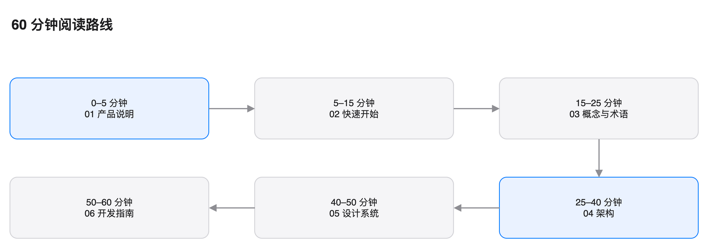

# Nook 文档

## 读完能做什么

你不需要先读代码。按顺序读 60 分钟，你能：

1. 说出 Nook 为谁解决什么问题。
2. 画出讲稿从输入到提词面板的路径。
3. 找到断句、界面和 AI 请求的代码。
4. 在本机构建并运行 Nook。
5. 修改一个小功能并验证。

## 60 分钟路线

| 时间 | 读 | 读完你能做 |
| --- | --- | --- |
| 0–5 分钟 | [01 产品说明](01-what-is-nook.md) | 说清产品与用户 |
| 5–15 分钟 | [02 快速开始](02-quick-start.md) | 在本机跑起来 |
| 15–25 分钟 | [03 概念与术语](03-concepts.md) | 用术语描述数据流 |
| 25–40 分钟 | [04 架构](04-architecture.md) | 画出模块和依赖 |
| 40–50 分钟 | [05 设计系统](05-design-system.md) | 找到颜色、字号和动效 |
| 50–60 分钟 | [06 开发指南](06-development.md) | 改一个功能并验证 |

## 文档地图

## 三种读法

- **只想使用 Nook。** 读 02。遇到问题再读 08。
- **想修改代码。** 读 02、03、04、06。需要细节时查 09。
- **想审查设计。** 读 04、05、07。再看 08 的限制。

## 写作约定

这套文档按 ASD-STE100 的等价中文规则编写。

- 一句只写一个意思。
- 操作句不超过 20 个汉字。
- 说明句不超过 25 个汉字。
- 一段不超过 6 句。
- 术语只用一个译名。见 [03 概念与术语](03-concepts.md)。
- 步骤以动词开头。

我们不声称通过 ASD 官方认证。我们只用可检查的规则约束写作。

检查命令：

~~~bash
./scripts/check-docs.py
~~~

## 术语与拼写

- 产品名统一写 Nook。
- 代码标识符保持英文，例如 `PromptDocument`。
- 快捷键写作 ⌘↩、⌃⌥Space。

## 下一步

打开 [01 产品说明](01-what-is-nook.md)。
